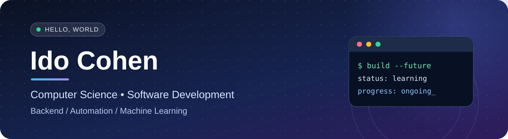

 

**Computer Science Student @ Bar-Ilan University**

Building reliable software, exploring intelligent systems, and learning how things work under the hood.

---

## ✨ About Me

I'm **Ido Cohen**, a Computer Science student at **Bar-Ilan University**. I enjoy solving problems and turning ideas into working software — from full-stack applications and APIs to data-driven systems and low-level programming.

- 🔭 **What I build:** backend services, web applications, automation, and database-driven tools
- 🧠 **What I explore:** machine learning, algorithms, operating systems, and software architecture
- 🤝 **How I work:** curious, systematic, and collaborative

## ⚡ Tech Stack

**Languages**

**Frameworks & Tools**

**Databases**

## 🚀 Featured Projects

<table>
<tr>
<td width="50%" valign="top">

### 🌍 [EcoGuard Agents](https://github.com/YonatanReich/EcoGuard-Agents)

**Environmental monitoring · Collaborative project**

A multi-agent environmental monitoring and decision-support system that combines hazard detection, analysis, response planning, and a live dashboard.

`Python` `FastAPI` `PostGIS` `React` `TypeScript`

</td>
<td width="50%" valign="top">

### 🍽️ [FoodWise](https://github.com/idocohen11/FoodWise)

**Recipe discovery · Relational databases**

A web app for recipe searches, pantry management, meal recommendations, favorites, and interactive SQL exploration.

`Python` `Flask` `MySQL` `JavaScript`

</td>
</tr>
<tr>
<td width="50%" valign="top">

### ▶️ [YouTube Clone](https://github.com/idocohen11/YouTube-Clone)

**Full-stack web development**

A video platform project with separate frontend and backend components.

`React` `Node.js` `Express` `MongoDB`

</td>
<td width="50%" valign="top">

### 🧱 [Brick Breaker](https://github.com/idocohen11/Brick-Breaker)

**Object-oriented Java game**

An Arkanoid-inspired game featuring levels, collision detection, controls, and scoring.

`Java` `OOP`

</td>
</tr>
</table>

## 📚 Computer Science Foundations

`Object-Oriented Programming` · `Operating Systems` · `Assembly & Low-Level Programming` · `Machine Learning` · `Data Structures & Algorithms` · `Software Engineering` · `Automated Testing`

---

**Thanks for stopping by!** ✨

Always learning. Always building.

